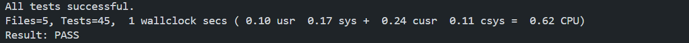

# Testing: what is proven, and where

How to run everything is in the [README Testing section](../README.md#testing). This page lists each rule and the test that proves it.

**Current results:** see the latest run of the CI workflow on the Actions tab (the badge in the README links to it). Jest, pgTAP and type checks run there; database tests are not run locally.

Pain, social health and management tests share some file names (`validate.test.ts`, `messages.test.ts`, `summary.test.ts`); they are in `src/features/assessments/pain/`, `src/features/assessments/social-health/` and `src/features/assessments/management/`.

## Traceability

| Rule or decision | Test that proves it | Layer | CI job |
| ---------------- | ------------------- | ----- | ------ |
| A week runs Monday to Sunday | `week.test.ts` (`getWeekStart` cases, Sunday belongs to the previous Monday, year boundary, 7 consecutive dates across the Melbourne daylight-saving start); `010_pain_constraints` ("week_start is the Monday of the chosen date") | Unit, Database | `unit-tests`, `database-tests` |
| One submission per user per week | `010_pain_constraints` ("a second submission in the same week is rejected"); `030_save_pain_assessment` ("second submission in the same week fails with 23505") | Database | `database-tests` |
| Pain levels follow mildest ≤ current ≤ worst, average between mildest and worst | `010_pain_constraints` ("a worst level below the current level is rejected"); `validate.test.ts` (ordering cases) | Database, Unit | `database-tests`, `unit-tests` |
| Pain levels are required (NOT NULL) | `010_pain_constraints` ("a missing pain level is rejected") | Database | `database-tests` |
| Pain levels are whole numbers from 0 to 10 | `validate.test.ts` (decimal such as 3.5, values below 0 or above 10, NaN) | Unit | `unit-tests` |
| A level of 0 is a real answer, not "missing" | `validate.test.ts` ("accepts 0 as a real answer") | Unit | `unit-tests` |
| Users cannot read each other's pain data | `020_pain_rls` (user A and user B each see only their own pain row) | Database | `database-tests` |
| Users only see their own `users` row | `020_pain_rls` (own `users` row count is 1 for each user) | Database | `database-tests` |
| An appointment needs only a date and time; doctor and service are optional, and a blank one is rejected rather than stored | `040_appointment_schema` (nullable columns, insert with only `patient_id` and `date_time`, empty and whitespace-only values rejected with 23514) | Database | `database-tests` |
| A recording-consent signature cannot be stored without a consent time | `040_appointment_schema` (signature without `recording_consent_at` rejected with 23514) | Database | `database-tests` |
| The logged-in role can read, create and update appointments but not delete them, and anon has no access | `040_appointment_schema` (`has_table_privilege` checks) | Database | `database-tests` |
| Users cannot see or change each other's appointments | `040_appointment_schema` (user B sees none of user A's rows and updates 0 rows) | Database | `database-tests` |
| Every table has row level security | `000_rls_enabled` | Database | `database-tests` |
| The logged-in role has the table privileges it needs, and cannot update or delete pain entries | `025_table_privileges`; `030_save_pain_assessment` (privilege checks) | Database | `database-tests` |
| Saving is atomic: if a child insert fails, no parent row remains | `030_save_pain_assessment` (temporary trigger forces a failure; row count unchanged) | Database | `database-tests` |
| The save function rejects a future date, a date before the start week, a missing profile, no location, no characteristic, a value over 45 characters, and anonymous callers | `030_save_pain_assessment` | Database | `database-tests` |
| Locations are stored in one canonical form (`lower back` becomes `Lower Back`, duplicates collapse, `Other` and 46 characters are rejected) | `normalise.test.ts`; `validate.test.ts` | Unit | `unit-tests` |
| A characteristic must be one of the seven options | `normalise.test.ts` (`isValidCharacteristic`); `validate.test.ts` | Unit | `unit-tests` |
| Database errors map to app error codes (including 23502 to `VALIDATION`) | `errors.test.ts` | Unit | `unit-tests` |
| Saving sends normalised values, and a bad answer never reaches the database | `assessments.test.ts` (`savePainEntry`) | Service | `unit-tests` |
| A retry after a lost response is treated as success; a different stored entry stays `DUPLICATE_WEEK` | `assessments.test.ts` | Service | `unit-tests` |
| Read functions filter by `week_start` and by the signed-in `auth_id`, and report `NO_SESSION` / `NO_PROFILE` | `assessments.test.ts` (`getPainEntryForWeek`, `getCompletedPainWeeks`, `getUserStartWeek`, `getRecentPainLocations`) | Service | `unit-tests` |
| Each save failure shows a friendly message, and raw database text is never shown to the user | `messages.test.ts` | Unit | `unit-tests` |
| The Summary screen shows the Monday to Sunday week, the saved values and the score wording (including 0 and 10) | `summary.test.ts` | Unit | `unit-tests` |
| One social health submission per user per week | `040_social_health_constraints` ("a second submission in the same week is rejected"); `050_save_social_health_assessment` ("a second submission in the same week fails with 23505") | Database | `database-tests` |
| Social health `week_start` is the Monday of the chosen date | `040_social_health_constraints`; `050_save_social_health_assessment` | Database | `database-tests` |
| Social health slider answers are whole numbers 0 to 10 | social health `validate.test.ts`; `040` and `050` (above 10 rejected) | Unit, Database | `unit-tests`, `database-tests` |
| Social life and travelling must be one of the listed statements | social health `validate.test.ts` (`UNKNOWN_OPTION`); `050` (blank or missing rejected with `MISSING_ANSWER`) | Unit, Database | `unit-tests`, `database-tests` |
| The mood answer is stored as the full "I was feeling ..." sentence | `mood.test.ts`; `040` and `050` (the short word is rejected) | Unit, Database | `unit-tests`, `database-tests` |
| Users cannot read each other's social health | `045_social_health_rls` | Database | `database-tests` |
| Logged-in users can read and insert social health but not edit or delete it; anon has no access | `046_social_health_privileges`; `050` (function execute privileges) | Database | `database-tests` |
| The social health save function rejects a future date, a date before the start week, a blank answer and a missing profile | `050_save_social_health_assessment` | Database | `database-tests` |
| A blank mood trigger is stored as NULL | social health `validate.test.ts`; `050` ("a blank reflection is stored as NULL") | Unit, Database | `unit-tests`, `database-tests` |
| Social health total = statement points (0-5 by position) + three sliders; bands 0-10 / 11-20 / 21-30 / 31-40 | `scoring.test.ts` (every band boundary, unknown statement) | Unit | `unit-tests` |
| The social health Summary shows the saved week, the band phrase and the existing result wording | social health `summary.test.ts` | Unit | `unit-tests` |
| Saving social health sends validated values, bad answers never reach the database, and a lost-response retry succeeds | `social-health.test.ts` | Service | `unit-tests` |
| Database errors map to app codes (including `MISSING_ANSWER`) and show friendly social health messages | `errors.test.ts`; social health `messages.test.ts` | Unit | `unit-tests` |
| One management submission per user per week | `060_management_constraints`; `070_save_management_assessment` (23505) | Database | `database-tests` |
| Management `week_start` is the Monday of the chosen date | `060`, `070` | Database | `database-tests` |
| Exercise is required and must be one of the five options | management `validate.test.ts`; `060` (23502); `070` (`MISSING_ANSWER`) | Unit, Database | `unit-tests`, `database-tests` |
| "I didn't take any medication" cannot be combined with a medication | `medication.test.ts`; management `validate.test.ts`; `070` (`MEDICATION_CONFLICT`) | Unit, Database | `unit-tests`, `database-tests` |
| "None" and "skipped" are stored differently | `070` (`no_medication` true, no names); management `summary.test.ts` | Database, Unit | `database-tests`, `unit-tests` |
| Medication names are trimmed, de-duplicated, non-blank and at most 100 characters | management `validate.test.ts`; `060` (blank rejected); `070` | Unit, Database | `unit-tests`, `database-tests` |
| Blank OTC and emotion answers are stored as NULL | management `validate.test.ts`; `070` | Unit, Database | `unit-tests`, `database-tests` |
| Saving management is atomic: a failing medication name insert leaves no management row | `070` (temporary trigger) | Database | `database-tests` |
| Users cannot read each other's management data or medication names | `065_management_rls` | Database | `database-tests` |
| Logged-in users can read and insert management data but not edit or delete it; anon has no access | `066_management_privileges`; `070` (function execute privileges) | Database | `database-tests` |
| The management save function rejects a future date, a date before the start week and a missing profile | `070_save_management_assessment` | Database | `database-tests` |
| The management Summary uses the agreed wording for every exercise/medication combination | management `summary.test.ts` | Unit | `unit-tests` |
| Saving management sends validated values; a lost-response retry succeeds | `management.test.ts` | Service | `unit-tests` |
| Database errors map to app codes (including `MEDICATION_CONFLICT`) and show friendly management messages | `errors.test.ts`; management `messages.test.ts` | Unit | `unit-tests` |
| Local numbers become `+614...` and anything that is not an Australian mobile is rejected | `phone.test.ts` (accepted shapes, rejected input, idempotence, display format) | Unit | `unit-tests` |
| The sign-in code is exactly six digits | `otp.test.ts` | Unit | `unit-tests` |
| A bad phone number or code never reaches Supabase; verifying returns only a user id | `src/services/auth.test.ts` | Service | `unit-tests` |
| Auth and profile errors map to app codes, and the friendly text never reveals whether an account exists | `errors.test.ts`; `src/features/auth/messages.test.ts` | Unit | `unit-tests` |
| Onboarding answers map to the database values (sex casing, user type, E.164 phone, conditions) | `src/features/auth/profile.test.ts` | Unit | `unit-tests` |
| Creating a profile never sends bad answers or a user id, and a retry after a lost response succeeds | `src/services/profile.test.ts` | Service | `unit-tests` |
| Profile creation is atomic, rejects a second profile, and validates name, phone, sex, year and conditions | `061_create_profile` | Database | `database-tests` |
| A user cannot see another user's profile rows; a support person gets a `users` row only | `061_create_profile` | Database | `database-tests` |
| Logged-in users can insert and read the profile tables but not update or delete; anon has no access and cannot run `create_profile` | `060_profile_privileges` | Database | `database-tests` |
| Resetting the onboarding answers clears them | `__tests__/onboarding-context.test.tsx` | Unit | `unit-tests` |
| The generated types match the migrations | CI step "Generated types match the migrations" (`supabase gen types --local` compared with `src/types/database.ts`) | Static | `database-tests` |
| No lint errors, no type errors | `npm run lint`, `npm run typecheck` | Static | `static-checks` |

## Not automated

These are not covered by an automated test, so no coverage is claimed for them.

- The Finish button cannot be double-submitted (UI behaviour; checked by hand).
- The social health Record button cannot be double-submitted (UI behaviour; checked by hand).
- The social health Summary screen rendering and the tips link (no component tests).
- Social health save atomicity: not applicable, the function makes a single insert.
- The management Record button cannot be double-submitted (UI behaviour; checked by hand).
- The medication screen's exclusive tick behaviour on screen (the rule itself is unit-tested in `medication.test.ts`).
- The management Summary screen rendering and the tips link (no component tests).
- That an untouched slider writes 0 in the UI (the validator accepts 0; the screen itself is checked by hand).
- Screens and components in general: there are no component tests.
- Real SMS delivery and the code's expiry time (test OTP numbers send nothing; checked by hand when Twilio is connected).
- The verify screen layout, the routing between the auth screens and the tabs, the root guard, and sign-out resetting onboarding (manual checklist in `docs/backend/login-backend-build-plan.md` section 5).

## Not tested / deferred

- Formatting check in CI (`prettier --check`): the repository has mixed line endings, so it would fail on most existing files.
- Deploy pipeline, EAS builds, branch protection and required checks.
- UI component tests.
- Coverage thresholds. The coverage report is produced and uploaded by CI, but nothing fails on a percentage.

## Evidence

Database tests passing (72 checks across 6 files):

- Social health database tests passing: **TODO**, screenshot of `supabase test db` to be saved as `docs/screenshots/db-tests-social-health.png`.
- Management database tests passing: **TODO**, screenshot of `supabase test db` with `060`–`070` passing to be saved as `docs/screenshots/db-tests-management.png`.
- Unit tests passing: **TODO**, screenshot of `npm test` to be saved as `docs/screenshots/unit-tests-passing.png`.
- Green CI checks on a pull request: **TODO**, `docs/screenshots/ci-green.png`.
- GitHub Actions run page: **TODO**, `docs/screenshots/ci-run.png`.
